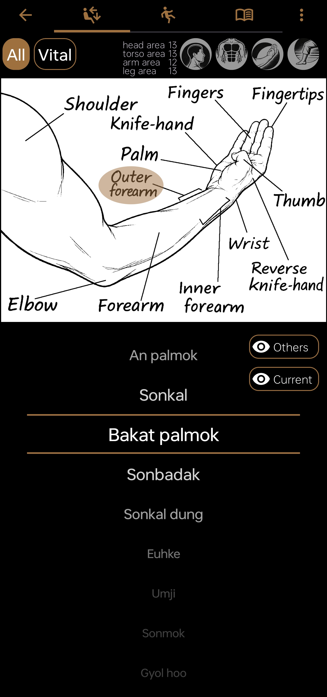
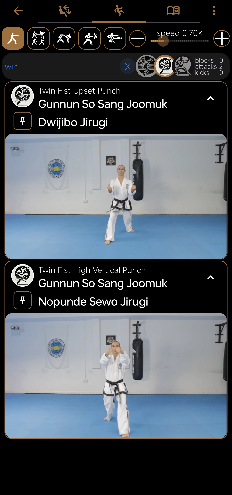
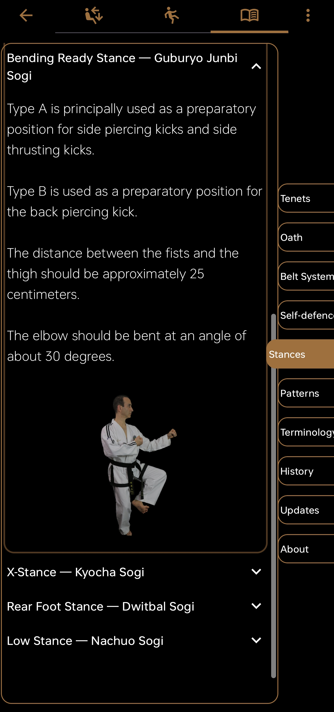
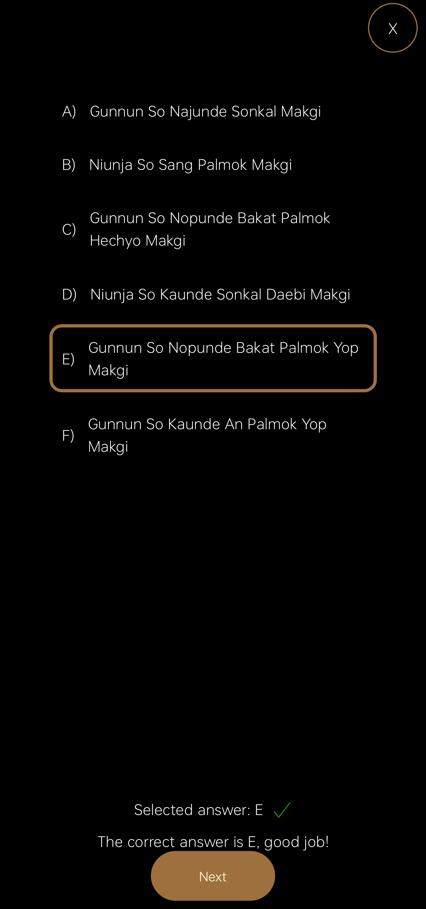

## ITF Taekwon-Do Training Support App

**This app is designed to support your ITF Taekwon-Do training.**  
Use it to **review and recall techniques** you have already learned, *not* as a tool for learning new ones.

### Screenshots

  
  
  
  

### Main Features
- Browse technique, pattern, crushing, special and sparring videos
- Filter content with belt-level and category
- Adjust video playback speed and pin technique videos for comparison
- Learn Korean words with interactive body diagrams
- Study Taekwon-Do theory and fundamentals
- Test your knowledge with quizzes on techniques, body parts and terminology
- Download and store content locally for offline use 
- Update content in-app from the cloud :globe_with_meridians:

### Video Sources & Credits

The app uses video clips from the following creators:

- [Donato Nardizzi](https://www.youtube.com/@DonatoNardizzi) — Patterns, sparring, blocks, attacks and kicks
- [Brendan Doogan](https://www.youtube.com/@bdtkd) — Crushing and special techniques

Additional clips are sourced from:

- [Nora TKD](https://www.youtube.com/@NoraTKD/videos)
- [East Cork TKD](https://www.youtube.com/@ectkdcarrigtwohill)
- [TKD Coaching](https://www.youtube.com/@Tkdcoaching)
- [Irish Taekwon-Do Association](https://www.youtube.com/@irishtkdassociation/videos)

### Download Instructions
- Download the **.apk file** for Android installation from:  
  [https://github.com/JuhaniLQ/Taekwon-Do_app/releases](https://github.com/JuhaniLQ/Taekwon-Do_app/releases)

- Or get the **latest version** directly:  
  [https://github.com/JuhaniLQ/Taekwon-Do_app/releases/download/v1.0/ITFun_v1.0_release.apk](https://github.com/JuhaniLQ/Taekwon-Do_app/releases/download/v1.0/ITFun_v1.0_release.apk)

### Tech Stack
- Kotlin  
- Jetpack Compose  
- Room (SQLite)
